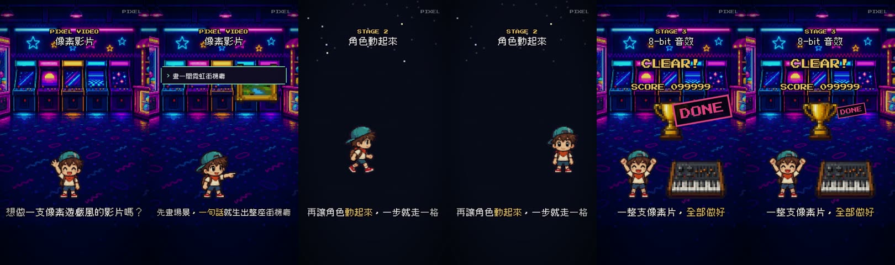

# pixel-video:用 Claude Code 做像素遊戲風短片

一個給 [Claude Code](https://claude.com/claude-code) 用的 skill。跟 Claude 說「幫我把這段講稿做成像素遊戲風的影片」,
它會一路從簡報、分鏡、AI 生場景和角色、排畫面、配 8-bit 音效,到渲染 60fps 的直式成片。不會畫畫也行。



三個關卡:

1. **畫場景**:AI 生圖後減到 96 色、對齊 6px 格子,變成真正的像素畫(還會自動做出「從馬賽克變清楚」的進場)
2. **角色動起來**:一張素材表生出一整排動作,自動切開、去背、補外框;走路一步就是一格
3. **配音效**:8-bit 音效用程式直接合成,每個動作(腳步、落地、打字、跳號、過關)自動對上

- 直式 1080×1920、60fps,適合 Reels / 抖音 / Shorts
- 畫面寫成一份 `storyboard.json`,每個動作錨在「第幾句旁白」,錄好配音重跑一次就全部對齊
- 生圖有 Codex CLI 就全自動;沒有就給你提示詞,貼到 ChatGPT 生
- 加碼:14 個做過的像素場景提示詞(街機廳、關卡地圖、小鎮、地城、Boss 房、海底、太空站…)

## 安裝

需要:Claude Code、Node.js 18 以上、Python 3.9 以上(加 Pillow、NumPy)、ffmpeg。

```bash
git clone https://github.com/ShabiSung/pixel-video ~/.claude/skills/pixel-video
pip install pillow numpy
```

Windows 的 skills 目錄是 `C:\Users\<你的帳號>\.claude\skills\`。只想在某個專案裡用,就放到那個專案的 `.claude/skills/pixel-video/`。

## 使用

在 Claude Code 裡直接說:

> 幫我做一支 45 秒的像素風影片,講複利是什麼,主角是一隻小雪人,世界是下雪的山坡

或輸入 `/pixel-video`。Claude 會先問你幾個問題(長度、主角、世界觀、配音),給你分鏡表確認、生好角色給你看,
之後自己做到成片再交給你。

想先看範例:把 `template/` 複製出來,依序跑

```bash
python tools/setup.py      # 下載 GSAP(約 70 KB)
python tools/process.py    # 範例原圖 → 像素素材
python tools/build.py      # 排片 + 合成音效
npx --yes hyperframes@0.8.31 render -q high -o renders/demo.mp4
```

## 授權

- 這個 skill 用 Apache-2.0 授權;附的字型俐方體 11 號、Press Start 2P 是 SIL Open Font License(授權檔在 `template/assets/fonts/`)。
- `template/assets/gen/` 的範例原圖是我們用 AI 生成的,可以跟著 skill 一起用。
- 渲染用 [HyperFrames](https://github.com/heygen-com/hyperframes),動畫用 [GSAP](https://gsap.com)。詳見 `NOTICE`。
- 做好的影片歸你。請不要拿它生成別人的角色、商標或真人。

## 資料夾

```
SKILL.md        Claude 讀的主說明(六關流程、規則、最常踩的坑)
references/     像素規則、生圖、storyboard 寫法、聲音、場景提示詞
template/       開新專案時整個複製出去的程式(範例片)
```

---

**English:** A Claude Code skill for making vertical (9:16) pixel-art / retro-game style short videos: AI-generated scenes
snapped to a 6px grid with a 96-color palette, sprite sheets auto-sliced into transparent frames, step-by-step sprite
animation, procedurally synthesized 8-bit SFX, and HyperFrames rendering at 60fps. Docs are in Traditional Chinese.
Licensed under Apache-2.0.
